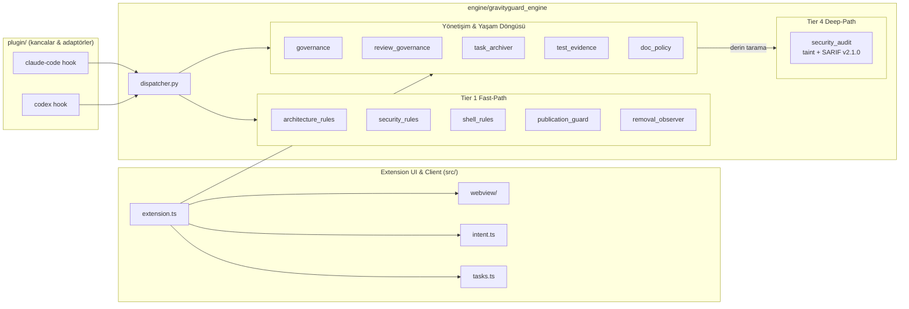

# GravityGuard — Otomatik Mimari Raporu

> Üretim tarihi: 2026-10-25
> GravityGuard sürümü: 1.4.18
> Bu dosya `npm run docs:arch` ile üretilir; elle düzenlemeyin.

## Genel Metrikler

- Toplam dosya: **109**
- Dolu satır (non-empty LOC): **22316**
- Test dosyası: **39**, test sayısı: **428**

| Alan | Dosya | Dolu satır |
|---|---:|---:|
| `engine` | 27 | 10171 |
| `plugin` | 10 | 651 |
| `src` | 32 | 5635 |
| `tests` | 40 | 5859 |

## Bileşen & Veri Akışı



## Katman ve Sorumluluk Matrisi

| Katman | Sorumluluk | Dosya | Dolu satır |
|---|---|---:|---:|
| Tier 1 Fast-Path Guardrail | Hızlı, deterministik kural kapıları (her araç çağrısında) | 5 | 1046 |
| Tier 4 Deep-Path Güvenlik Denetçisi | Derin tarama: taint tracking, SARIF v2.1.0, git tree-hash bağlama | 1 | 417 |
| Yönetişim & Yaşam Döngüsü | Kapılar, inceleme, görev arşivi, test kanıtı, doküman politikası | 5 | 1741 |
| Extension UI & Client | VS Code uzantısı: komutlar, niyet, webview, görevler | 24 | 3874 |
| Testler | Python + Node test paketleri (428 test) | 39 | 5859 |

## Dizin Ağacı

```text
├── engine/
│   ├── gravityguard_engine/
│   │   ├── __init__.py
│   │   ├── architecture_rules.py
│   │   ├── audit.py
│   │   ├── audit_maintenance.py
│   │   ├── diagnostics.py
│   │   ├── diffing.py
│   │   ├── dispatcher.py
│   │   ├── doc_policy.py
│   │   ├── governance.py
│   │   ├── local_paths.py
│   │   ├── operations.py
│   │   ├── policy_integrity.py
│   │   ├── project_context.py
│   │   ├── publication_guard.py
│   │   ├── removal_observer.py
│   │   ├── review_governance.py
│   │   ├── review_policy.py
│   │   ├── security_audit.py
│   │   ├── security_rules.py
│   │   ├── shell_rules.py
│   │   ├── state_lock.py
│   │   ├── task_archiver.py
│   │   └── test_evidence.py
│   ├── tests/
│   │   ├── __init__.py
│   │   ├── test_architecture_rules.py
│   │   ├── test_audit.py
│   │   ├── test_audit_maintenance.py
│   │   ├── test_audit_reliability.py
│   │   ├── test_claude_adapter.py
│   │   ├── test_doc_overwrite_guard.py
│   │   ├── test_doc_policy.py
│   │   ├── test_env_protection.py
│   │   ├── test_generate_architecture.py
│   │   ├── test_governance.py
│   │   ├── test_governance_control.py
│   │   ├── test_local_paths.py
│   │   ├── test_operations.py
│   │   ├── test_project_context.py
│   │   ├── test_removal_observer.py
│   │   ├── test_review_governance.py
│   │   ├── test_review_policy.py
│   │   ├── test_security_audit.py
│   │   ├── test_security_hardening.py
│   │   ├── test_security_rules.py
│   │   ├── test_state_lock.py
│   │   ├── test_task_archiver.py
│   │   └── test_test_evidence.py
│   ├── async_runner.py
│   ├── governance_control.py
│   ├── gravity-validator.py
│   └── test_gravity_validator.py
├── plugin/
│   ├── claude-code/
│   │   ├── README.md
│   │   ├── gravityguard_claude_hook.py
│   │   └── settings.example.json
│   ├── codex/
│   │   └── gravityguard_codex_hook.py
│   ├── rules/
│   │   └── gravityguard_invariants.md
│   ├── skills/
│   │   ├── core-docs/
│   │   │   └── SKILL.md
│   │   └── srp-modularizer/
│   │       └── SKILL.md
│   ├── gravityguard_hook_safety.py
│   ├── hooks.json
│   └── plugin.json
├── src/
│   ├── i18n/
│   │   └── index.ts
│   ├── webview/
│   │   ├── styles/
│   │   │   ├── base.ts
│   │   │   ├── insights.ts
│   │   │   └── stream.ts
│   │   ├── tabs/
│   │   │   ├── insights.ts
│   │   │   ├── knowledge.ts
│   │   │   ├── live.ts
│   │   │   ├── obligations.ts
│   │   │   ├── rules.ts
│   │   │   ├── skills.ts
│   │   │   └── tasks.ts
│   │   ├── client.ts
│   │   ├── governance_control.ts
│   │   ├── html_utils.ts
│   │   ├── layout.ts
│   │   ├── lifecycle.ts
│   │   ├── message_policy.ts
│   │   ├── provider.ts
│   │   ├── state.ts
│   │   ├── styles.ts
│   │   ├── tabs.ts
│   │   └── types.ts
│   ├── commands.ts
│   ├── extension.ts
│   ├── icons.ts
│   ├── intent.ts
│   ├── knowledge.ts
│   ├── router_client.ts
│   ├── router_security.ts
│   ├── skills.ts
│   ├── tasks.ts
│   └── view_filter.ts
└── tests/
    ├── agent_identity.test.mjs
    ├── codex_adapter.test.mjs
    ├── i18n.test.mjs
    ├── icons.test.mjs
    ├── intent-corpus.test.mjs
    ├── intent.test.mjs
    ├── knowledge.test.mjs
    ├── obligations.test.mjs
    ├── security_boundaries.test.mjs
    ├── skills.test.mjs
    ├── tasks.test.mjs
    ├── view_filter.test.mjs
    ├── webview_lifecycle.test.mjs
    ├── webview_lifecycle_model.test.mjs
    ├── webview_real_lifecycle.test.mjs
    └── webview_recovery.test.mjs
```
