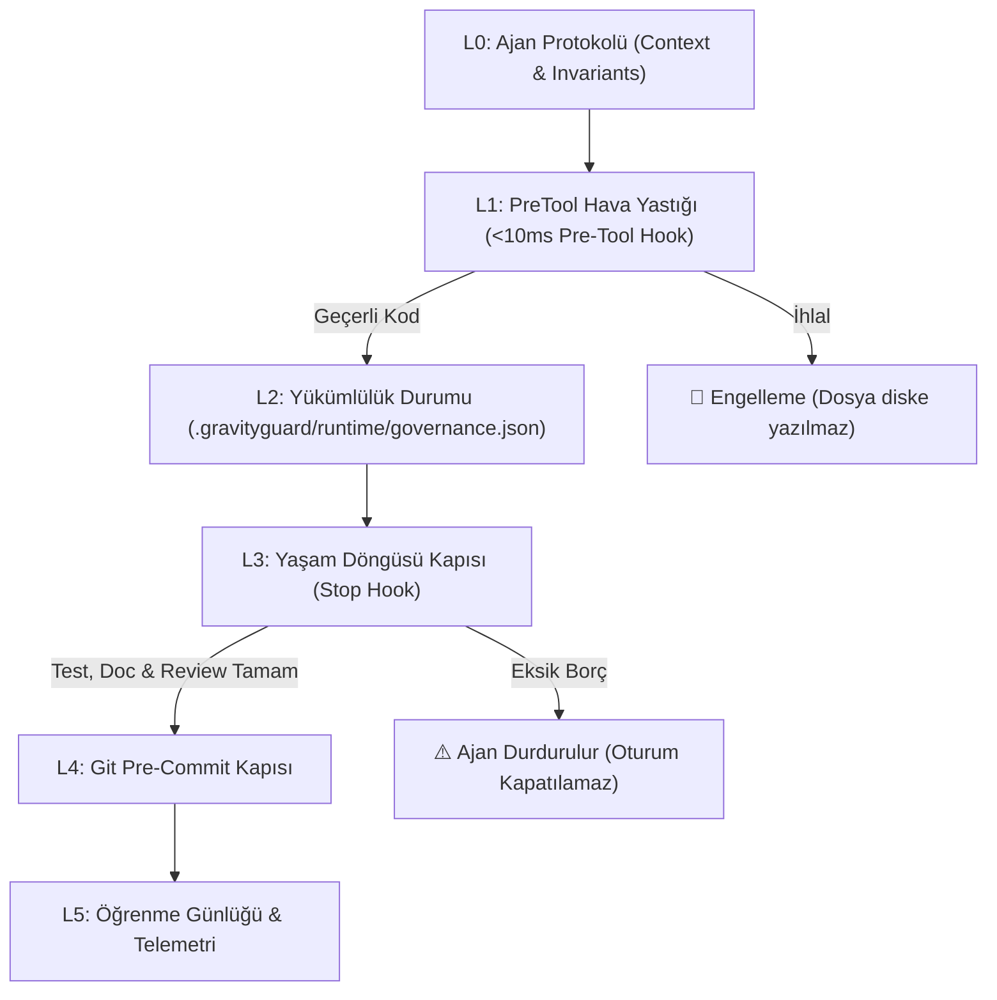

# 🏗️ GravityGuard Mimarisi — 5 Katmanlı Yaşam Döngüsü & Çift Motor

GravityGuard, yapay zeka kodlama ajanlarını tek bir aşamada denetlemek yerine, kodun ilk yazılışından Git reposuna commit edilmesine kadar **5 Katmanlı Bir Yaşam Döngüsü (5-Layer Obligation Governance)** uygular.

---

## 1. Katmanlar (L0 - L5)

### L0: Ajan Protokolü (Agent Invariants)
- Dosyalar: `docs/KNOWLEDGE.md` §0 ve `.gravityguard/CONTEXT.md`.
- Ajan oturumu başladığında bağlama yüklenen temel kurallar ve kırmızı çizgilerdir. Ajan neyin yasak olduğunu önceden bilir.

### L1: PreTool Hava Yastığı (Milisaniyelik Koruma)
- Tetiklenme: Ajan `write_file`, `edit_file`, `replace_file_content` çağırdığı an.
- Hız: Bellekte `<10ms` (tipik olarak 0.05 - 0.5 ms).
- Görevi: Dosya **diske hiç yazılmadan önce** secret (`G0`), `.env` kurcalama, boş except/catch (`G1`), katman ihlali (`G4`), kör üzerine yazma (`G4_BLIND`) ve dosya büyümesini (`SRP`/`Growth`) tarar.
- Sonuç: Hata varsa `{"decision": "deny"}` döner ve işlem fiziksel olarak iptal edilir.

### L2: Asenkron Kanıt & Yönetişim Durumu
- Dosya: `.gravityguard/runtime/governance.json`
- Görevi: Bir üretim dosyası başarıyla değiştirildiğinde, ajan üzerine asenkron borçlar yazar:
  - `test_obligations`: Hangi testin çalıştırılması veya yazılması gerektiği (`T1`).
  - `doc_obligations`: `CHANGELOG.md` güncelleme zorunluluğu (§6 kuralı).
  - `review_obligations`: Kod inceleme zorunluluğu (`R1`).

### L3: Yaşam Döngüsü Kapısı (Stop Hook)
- Tetiklenme: Ajan "İş bitti, oturumu kapatıyorum" dediğinde.
- Görevi: Ajanın üzerinde çözülmemiş test kanıtı, dokümantasyon veya inceleme borcu varsa `{"decision": "continue", "reason": "..."}` döndürerek ajanı oturum içinde tutar ve eksikleri tamamlamasını emreder.
- Devre Kesici: Ajan döngüye girip 5 kez çözemezse devre kesici (circuit breaker) devreye girer.

### L4: Git Pre-Commit Kapısı
- Tetiklenme: Terminalde `git commit` yapıldığında.
- Görevi: `tools/verify_doc_governance.py` ve bağımsız secret tarayıcısı devreye girer. Git seviyesinde atlatmayı önler.

### L5: Öğrenme Günlüğü (Learning Ledger)
- Tetiklenme: Arka plan telemetri ve denetim analizleri.
- Görevi: Kalıcı denetim günlüğü (`gravityguard_permanent_audit.jsonl`), kurtarma oranları ve ajan davranış örüntülerini analiz eder.

---

## 2. Çift Motor (Dual Engine) Mimarisi

GravityGuard iki farklı çekirdeğin uyum içinde çalışmasıyla oluşur:

1. **TypeScript Motoru (`src/`)**:
   - VS Code / Antigravity uzantı yaşam döngüsünü yönetir.
   - Webview Monitörünü (Iframe-safe, Virtual DOM benzeri in-place render) çalıştırır.
   - Yerel niyet sınıflandırıcısına (`src/intent.ts`, <1ms) sahiptir.

2. **Python Güvenlik & Kural Motoru (`engine/`)**:
   - `gravity-validator.py` CLI ve araç kancası (tool hook) olarak çalışır.
   - Deterministik, AST ve Regex tabanlı kuralları işletir.
   - Write-Ahead Journaling (WAL) ve StateLock güvencesiyle denetim loglarını tutar.
