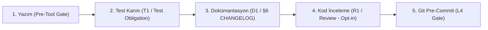

# 🔄 Bir Dosyanın Yaşam Döngüsü & Yükümlülük Hattı

GravityGuard'da bir kod dosyasının değişikliği, rastgele bir düzenleme değil; adım adım takip edilen **deterministik bir yaşam döngüsüdür (Obligation Pipeline)**.

---

## 1. Adım: Kodlama / Yazım Aşaması (Pre-Tool Gate)
Ajan `write_file` veya `edit_file` aracını çağırdığında:
- **G0 (Güvenlik)**: Secret veya `.env` içeriyor mu?
- **G1 (Exception)**: Sessiz hata yutulmuş mu?
- **G4 (Mimari)**: Yasaklı katmandan import yapılmış mı?
- **G4 (Kör Yazma)**: Dosya önce okunmadan körlemesine üzerine mi yazılıyor?
- **SRP / Boyut**: Dosya aşırı büyümüş mü?
👉 **Her şey temizse**: Dosya diske yazılır ve 2. adıma geçilir.

---

## 2. Adım: Test Kanıtı Aşaması (Test Obligation - T1)
- **Kapsam**: Yalnızca kritik üretim kodu (`src/`, `engine/`).
- **Aşırı Mühendislik (Over-Engineering) Önlemi**: UI dosyaları, demolar, şablonlar veya basit konfigürasyonlar için gereksiz test borcu yazılmaz!
- **Süreç**: Üretim dosyası değiştiğinde oturuma bir `test_obligation` eklenir. Ajan ilgili testi yazıp çalıştırana kadar oturumu kapatamaz (Stop Gate engeller).

---

## 3. Adım: Dokümantasyon Aşaması (Doc Obligation - §6 Kuralı)
- **Same-Commit Disiplini**: Kod ile dokümantasyon aynı commit içinde güncellenmelidir.
- Ajan kod değiştirdiğinde `CHANGELOG.md` dosyasına neyin değiştiğini yazmak zorundadır.

---

## 4. Adım: Kod İnceleme Aşaması (Review Obligation - R1)
- **Varsayılan Durum**: `review.enabled: false` (Yeni kuran kullanıcılar için kapalıdır, kilitlenme yaşanmaz).
- **Aktif Edildiğinde**:
  - **Self-Review (Aday Parmak İzi ile)**: Ajan kendi diff'ini 4 noktadan okur: 1) mantık hatası, 2) silinen test, 3) güncellenecek doküman, 4) uydurulmuş import/fonksiyon.
  - Ardından `.gravityguard/self-review/<id>.json` dosyasına `reviewId`, `sourceFingerprint` (yükümlülüğün parmak izi), `findings: []` ve en az 20 karakterlik `notes` yazar.
  - Kayıt şemaya uymuyorsa (`receipt-notes-too-short`, `receipt-findings-invalid`), parmak izi eşleşmiyorsa (`fingerprint-mismatch`) veya kod incelemeden sonra değiştiyse (`stale-candidate`) yükümlülük açık kalır.
  - Harici uzman ajan, MCP gözlemi ve imza yoktur; amaç unutmayı yakalamaktır, kötü niyeti değil.

---

## 5. Adım: Git Pre-Commit Kapısı (L4 Gate)
- Geliştirici veya ajan terminalde `git commit` komutunu çalıştırdığında `verify_doc_governance.py` ve `check_secrets.py` son kontrolü yapar.
- Eksik test, eksik CHANGELOG veya secret sızıntısı varsa commit reddedilir.
