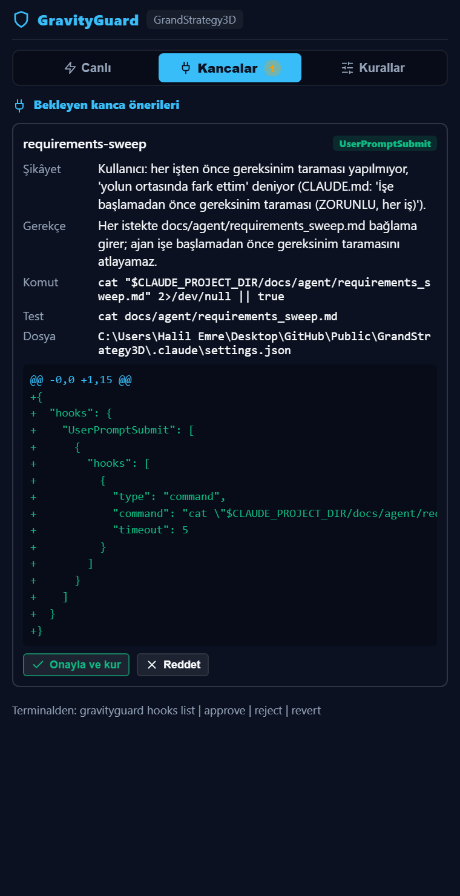

# Kanca önerileri (Hook Proposals)

Ajan bir kanca (hook) kuramaz: `.claude/settings.json`, `.claude/settings.local.json`, `.agents/hooks.json` ve
`.gravityguard/runtime/` `POLICY_INTEGRITY` ile ajana kapalıdır. Ajan bunun yerine bir **öneri** yazar; kullanıcı
farkı (diff) ve gerekçeyi görür, onaylarsa GravityGuard kancayı kurar.



## Akış

1. **Ajan önerir.** Kullanıcı tekrarlayan bir hatadan yakındığında ajan `.gravityguard/proposals/hooks/<id>.json`
   yazar. Bu klasör ajana açıktır.
2. **Kullanıcı inceler.** Panelde **Kancalar** sekmesi bekleyen öneriyi, şikâyeti, gerekçeyi, komutu ve hedef dosyaya
   eklenecek satırları gösterir. Terminalden: `gravityguard hooks list` ve `gravityguard hooks show <id>`.
3. **Kullanıcı onaylar ya da reddeder.** Panelde **Onayla ve kur** (sonra açılan pencerede **Evet**) ya da
   **Reddet**. Terminalden: `gravityguard hooks approve <id>` (farkı gösterir, kimliği yazmanızı ister) ve
   `gravityguard hooks reject <id> -r "neden"`.
4. **Geri alma.** Panelde kurulu önerinin **Geri al** düğmesi ya da `gravityguard hooks revert <id>`. Yalnızca
   onayın eklediği kanca silinir; dosyadaki diğer her şey kalır. Kanca elle değiştirilmişse hiçbir şey silinmez.

`gravityguard` komutu `bin/gravityguard` (bash) ve `bin/gravityguard.cmd` (Windows) dosyalarıdır. `bin` klasörünü
PATH'e ekleyin ya da `python <GravityGuard>/engine/gravityguard_cli.py hooks ...` yazın. Komut proje kökünde
çalıştırılır (`--root <klasör>` ile başka proje seçilir).

## Öneri biçimi

```json
{
  "id": "requirements-sweep",
  "target": "claude",
  "event": "UserPromptSubmit",
  "command": "cat \"$CLAUDE_PROJECT_DIR/docs/agent/requirements_sweep.md\" 2>/dev/null || true",
  "test": "cat docs/agent/requirements_sweep.md",
  "rationale": "Her istekte gereksinim taraması bağlama girer; ajan unutamaz.",
  "complaint": "Kullanıcı: her işten önce requirements_sweep okunmadı.",
  "created_by": "claude-code"
}
```

| Alan | Zorunlu | Anlamı |
|---|---|---|
| `id` | evet | Küçük harf, rakam, tire (3-64). Dosya adıyla aynı olur. |
| `target` | evet | `claude` → `.claude/settings.json`; `antigravity` (ya da `agents`) → `.agents/hooks.json` |
| `scope` | hayır | Yalnız claude: `project` (varsayılan) ya da `local` (`settings.local.json`) |
| `event` | evet | claude: `UserPromptSubmit`, `SessionStart`, `SessionEnd`, `PostToolUse`, `Stop`, `SubagentStop`, `Notification`, `PreCompact`. antigravity: `SessionStart`, `PostToolUse`, `Stop` |
| `matcher` | hayır | Olayın matcher'ı (en çok 200 karakter) |
| `command` | evet | Kurulacak komut (kurallar aşağıda) |
| `timeout` | hayır | 1-120 saniye, varsayılan 10 |
| `rationale` | evet | Kanca neyi önler |
| `complaint` | hayır | Kullanıcının hangi şikâyetinden çıktı |
| `test` | evet | Kullanıcının kancayı denemek için çalıştıracağı komut (aynı kurallar) |

## Reddedilen öneriler

Geçersiz öneri kurulmaz; panel ve CLI nedenini açıkça yazar.

- **Yalnızca ekleme.** Bilinmeyen alan (`remove`, `replace` vb.) reddedilir. Aynı komut o olayda zaten kuruluysa
  reddedilir. Mevcut kancalar silinmez ve değiştirilmez.
- **GravityGuard'a dokunmaz.** Komutta `gravityguard`, `gravity-validator` ya da onay aracı geçerse reddedilir.
- **İzin veren olaylar yok.** `PreToolUse` ve `PermissionRequest` bir aracı "izinli" sayıp kullanıcının izin
  sorusunu atlatabilir; bunları kullanıcı elle ekler.
- **Komut kuralları.** Komut `&&`, `||`, `;`, `|` ile bölünür. Her parça şunlardan biri olmalı:
  - `cat`, `type`, `Get-Content`, `head`, `tail` ile **proje içindeki** bir dosyayı okumak;
  - `python`, `node`, `bash`, `sh`, `pwsh`, `powershell` ile **proje içindeki var olan** bir betiği çalıştırmak
    (`-c`, `-e`, `-Command`, `-EncodedCommand`, `-m` gibi satır içi kod yasak);
  - `echo`, `printf`, `true`, `exit`.
  Proje kökü `$CLAUDE_PROJECT_DIR` ile yazılabilir. `curl`, `wget` ve diğer komutlar, dosyaya yönlendirme (`>`),
  `$(...)` ve arka plan çalıştırma reddedilir. Yalnız `2>/dev/null`, `>/dev/null`, `2>&1` serbesttir. Sır, `.env`
  okuma ve tehlikeli komut kuralları (`G0_*`) da uygulanır.
- **İnceleme sonrası değişiklik.** Onay, kullanıcının gördüğü içeriğin SHA-256 özetiyle yapılır. Öneri dosyası
  arada değiştiyse kurulum yapılmaz.

## Ajan onay veremez

- `gravityguard hooks approve|revert`, `engine/hook_proposal_control.py` ve `hook_proposals.approve/revert`
  çağrıları ajan kabuğunda `POLICY_INTEGRITY` ile reddedilir. Listeleme ve gösterme serbesttir.
- CLI'da `approve` ve `revert` etkileşimli bir terminal ister ve öneri kimliğinin elle yazılmasını bekler.
- Panel düğmeleri ayrıca VS Code onay penceresi açar.

Bu, kanca düzeyinde bir korumadır, işletim sistemi izni değildir (bkz. `policy_integrity.py`).

## Kayıt

Her karar `.gravityguard/runtime/hook-receipts/<id>.json` dosyasına yazılır (ajana kapalı): durum (`installed`,
`rejected`, `reverted`), öneri, eklenen tam girdi, hedef dosya ve tarihli geçmiş. Denetim günlüğüne
`HOOK_PROPOSAL_APPROVED`, `HOOK_PROPOSAL_REJECTED`, `HOOK_PROPOSAL_REVERTED` olayları düşer.
